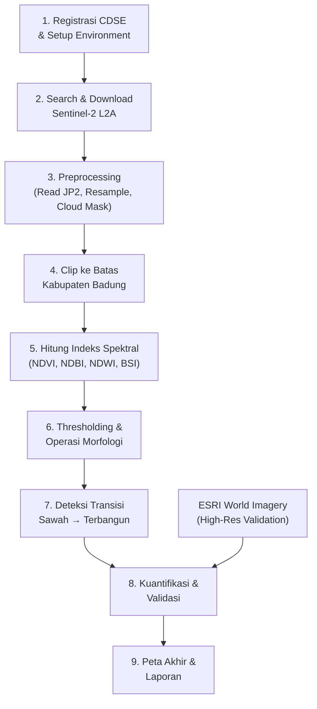

# 🗺️ Roadmap: Pipeline End-to-End Python — Deteksi Alih Fungsi Lahan Sawah di Kabupaten Badung

## Ringkasan Perubahan dari Laporan Sebelumnya

| Aspek | Sebelumnya (Laporan) | Sekarang (Rencana Baru) |
|---|---|---|
| **Platform utama** | Google Earth Engine | Python (lokal) |
| **Download citra** | Langsung dari GEE | Copernicus Data Space Ecosystem (CDSE) API |
| **Validasi visual** | Belum dibahas | ESRI World Imagery (sub-meter, gratis, tanpa API key) |
| **Pengolahan** | GEE JavaScript | rasterio + numpy + scipy/OpenCV |
| **Visualisasi** | GEE Map | matplotlib + folium |

---

## Arsitektur Pipeline



---

## Tahap 0: Prasyarat & Environment Setup

### 0.1 Registrasi Copernicus Data Space Ecosystem (CDSE)
- Buat akun **gratis** di https://dataspace.copernicus.eu
- Catat username & password (dipakai untuk download)
- **Ini wajib dilakukan duluan** — tanpa akun, tidak bisa download citra

### 0.2 Python Environment
```bash
# Buat virtual environment
python -m venv pratubes_env
pratubes_env\Scripts\activate  # Windows

# Install dependencies
pip install rasterio numpy scipy geopandas shapely matplotlib folium
pip install opencv-python pystac-client requests mercantile
pip install eodag    # Untuk search & download Sentinel-2
```

### 0.3 Struktur Folder Proyek

```
PRATUBES_BADUNG/
├── laporan.md                    # Laporan yang sudah ada
├── requirements.txt              # Dependencies
├── config.py                     # Konfigurasi (paths, thresholds, dll)
│
├── scripts/
│   ├── 01_download_sentinel.py   # Download citra dari CDSE
│   ├── 02_preprocessing.py       # Read, resample, cloud mask, clip
│   ├── 03_compute_indices.py     # Hitung NDVI, NDBI, NDWI, BSI
│   ├── 04_threshold_morphology.py # Thresholding & operasi morfologi
│   ├── 05_change_detection.py    # Deteksi transisi sawah → terbangun
│   ├── 06_validation.py          # Download high-res tiles, visual check
│   └── 07_visualization.py       # Peta akhir, statistik, export
│
├── data/
│   ├── raw/                      # SAFE folders dari Sentinel-2
│   ├── boundary/                 # Shapefile batas Kabupaten Badung
│   ├── processed/                # GeoTIFF hasil preprocessing
│   ├── indices/                  # GeoTIFF indeks spektral
│   └── results/                  # Output akhir
│
├── validation/
│   └── highres_tiles/            # Tile citra resolusi tinggi ESRI
│
└── output/
    ├── maps/                     # Peta akhir (PNG, HTML interaktif)
    └── statistics/               # CSV statistik luas, perubahan
```

---

## Tahap 1: Search & Download Sentinel-2 L2A

### Apa yang didownload?
| Parameter | Nilai |
|---|---|
| Koleksi | Sentinel-2 Level-2A (Surface Reflectance) |
| Tile | **T50LKR** dan **T50LLR** |
| Periode | Oktober 2018 dan Oktober 2026 |
| Filter awan | Metadata cloud cover < 40% |
| Format output | SAFE folder (band dalam JP2) |

### Library yang dipakai: `eodag`
`eodag` mendukung multi-provider, konfigurasi mudah, dan mature. Alternatif: `cdsetool` atau langsung OData API.

### Perkiraan ukuran download
- Setiap granula Sentinel-2 L2A ≈ 600 MB – 1 GB
- Oktober 2018: ~2 granula × 2 tile = ~4 file ≈ **2–4 GB**
- Oktober 2026: ~13 granula × kemungkinan duplikat tile = ~13 file ≈ **6–13 GB**
- **Total estimasi: 8–17 GB** (pastikan disk space cukup!)

> [!WARNING]
> Download bisa memakan waktu cukup lama (beberapa jam tergantung koneksi). Jalankan script download di malam hari atau saat koneksi stabil.

---

## Tahap 2: Preprocessing

### 2.1 Membaca Band JP2
Sentinel-2 L2A menyimpan band sebagai JPEG2000 (.jp2) dalam struktur SAFE folder:
```
SAFE/GRANULE/.../IMG_DATA/
├── R10m/  → B02, B03, B04, B08 (10m)
├── R20m/  → B05–B07, B8A, B11, B12, SCL (20m)
└── R60m/  → B01, B09, SCL (60m)
```

### 2.2 Resampling Resolusi

> [!IMPORTANT]
> Band yang kita butuhkan memiliki resolusi berbeda. Ini keputusan kritis.

| Band | Resolusi Asli | Dipakai untuk |
|---|---|---|
| B02 (Blue) | 10m | BSI |
| B03 (Green) | 10m | NDWI |
| B04 (Red) | 10m | NDVI, BSI |
| B08 (NIR) | 10m | NDVI, NDBI, NDWI, BSI |
| B11 (SWIR-1) | 20m | NDBI, BSI |
| B12 (SWIR-2) | 20m | (cadangan) |
| SCL | 20m | Cloud masking |

**Dua opsi:**
1. **Resample semua ke 10m** — lebih detail secara spasial, tapi B11 di-interpolasi (bilinear), SCL di-resample (nearest neighbor)
2. **Resample semua ke 20m** — konsisten dengan resolusi asli SWIR, tanpa interpolasi artifisial

**Rekomendasi:** Resample ke **10m** karena NDVI (B08, B04) memiliki resolusi asli 10m dan kita ingin mempertahankan detail spasial untuk deteksi sawah kecil. Gunakan **bilinear** untuk band reflektansi dan **nearest neighbor** untuk SCL (data kategoris).

### 2.3 Cloud Masking dengan SCL
Kelas SCL yang di-mask (sama dengan laporan sebelumnya):

| Nilai SCL | Kelas | Aksi |
|---|---|---|
| 0 | No Data | **Mask** |
| 1 | Saturated/Defective | **Mask** |
| 3 | Cloud Shadow | **Mask** |
| 8 | Cloud Medium Probability | **Mask** |
| 9 | Cloud High Probability | **Mask** |
| 10 | Thin Cirrus | **Mask** |
| 11 | Snow/Ice | **Mask** |

### 2.4 Komposit Median
- Untuk setiap piksel, ambil nilai median dari semua tanggal yang valid (setelah cloud mask)
- Sama seperti yang dilakukan di GEE, tapi sekarang di Python dengan numpy

### 2.5 Clip ke Batas Kabupaten Badung
- Sumber boundary: download shapefile dari GADM (gadm.org) atau BIG (batas resmi Indonesia)
- Clip menggunakan `rasterio.mask.mask()` dengan geometri dari GeoDataFrame

---

## Tahap 3: Hitung Indeks Spektral

Semua dihitung dengan numpy (operasi array, sangat cepat):

| Indeks | Formula | Band |
|---|---|---|
| **NDVI** | (B08 − B04) / (B08 + B04) | NIR, Red |
| **NDBI** | (B11 − B08) / (B11 + B08) | SWIR-1, NIR |
| **NDWI** | (B03 − B08) / (B03 + B08) | Green, NIR |
| **BSI** | ((B11+B04) − (B08+B02)) / ((B11+B04) + (B08+B02)) | SWIR-1, Red, NIR, Blue |

Output: GeoTIFF per indeks per tahun (total 8 file).

---

## Tahap 4: Thresholding & Operasi Morfologi

### 4.1 Thresholding
Parameter awal dari eksplorasi GEE sebelumnya:
- NDVI vegetasi: > 0.3
- NDBI terbangun: > 0.1

### 4.2 Operasi Morfologi
Menggunakan `scipy.ndimage` atau `cv2` (OpenCV):
- **Opening** (erosion → dilation): hapus noise kecil
- **Closing** (dilation → erosion): tutup lubang kecil
- Kernel: persegi 3×3 atau silang, dievaluasi

> [!TIP]
> Di Python kita punya kontrol lebih baik atas kernel morfologi — bisa bikin kernel custom, iterasi berbeda, bahkan kernel adaptif.

---

## Tahap 5: Deteksi Transisi Sawah → Terbangun

Logika deteksi (dari laporan):

$$C = (NDVI_{2018} > 0.3) \cap (NDVI_{2026} \leq 0.3) \cap (NDBI_{2026} > T) \cap (NDBI_{2026} > NDBI_{2018})$$

### Tambahan yang belum dilakukan:
1. **Filter NDWI** — keluarkan area air
2. **Filter BSI** — bedakan tanah terbuka dari terbangun
3. **Identifikasi sawah** — tambahkan kriteria temporal/tekstural untuk membedakan sawah dari hutan/kebun

---

## Tahap 6: Validasi dengan Citra High-Resolution

### Sumber: ESRI World Imagery (Rekomendasi Utama)
- **Resolusi:** Sub-meter (bervariasi per lokasi, umumnya 0.3–1m)
- **Gratis:** Ya, tanpa API key untuk akses tile dasar
- **Legal:** Fair use untuk akademik ✅
- **URL pattern:**
  ```
  https://server.arcgisonline.com/ArcGIS/rest/services/World_Imagery/MapServer/tile/{z}/{y}/{x}
  ```

### Cara validasi:
1. Ambil sampel lokasi kandidat transisi (misalnya 50–100 titik)
2. Download tile high-res ESRI di sekitar titik tersebut
3. Bandingkan visual: apakah benar ada bangunan baru di lokasi yang terdeteksi?
4. Hitung akurasi: berapa persen kandidat yang benar-benar terbangun?

### Sumber alternatif: Planet NICFI
- Resolusi 4.7m, gratis untuk riset
- Perlu registrasi di planet.com/nicfi
- Cocok untuk area tropis termasuk Indonesia/Bali

---

## Tahap 7: Peta Akhir & Statistik

### Output yang dihasilkan:
1. **Peta perubahan** — GeoTIFF dan PNG dengan legenda
2. **Peta interaktif** — HTML dengan folium (bisa zoom, overlay high-res)
3. **Statistik luas** — CSV/tabel total hektare kandidat transisi
4. **Confusion matrix** — akurasi validasi
5. **Laporan akhir** — update laporan.md

---

## Estimasi Waktu Pengerjaan

| Tahap | Estimasi |
|---|---|
| 0. Setup environment & registrasi CDSE | 30 menit |
| 1. Download citra | 2–6 jam (tergantung koneksi) |
| 2. Preprocessing | 2–3 jam coding + running |
| 3. Hitung indeks | 1 jam |
| 4. Thresholding & morfologi | 2–3 jam |
| 5. Deteksi transisi | 2–3 jam |
| 6. Validasi | 3–4 jam |
| 7. Peta & laporan | 2–3 jam |
| **Total** | **~15–25 jam kerja** |

> [!NOTE]
> Estimasi ini termasuk waktu debugging dan iterasi parameter. Waktu download citra berjalan di background.

---

## Keputusan yang Perlu Diambil Sekarang

| # | Keputusan | Opsi | Rekomendasi |
|---|---|---|---|
| 1 | **Resolusi kerja** | 10m vs 20m | **10m** (detail lebih baik untuk sawah kecil) |
| 2 | **Library download** | eodag vs cdsetool vs OData API | **eodag** (paling mature) |
| 3 | **Sumber boundary** | GADM vs BIG vs GAUL | **GADM** (mudah download, format shapefile) |
| 4 | **Validasi high-res** | ESRI World Imagery vs Planet NICFI | **ESRI** (tanpa registrasi tambahan) |
| 5 | **Mulai dari mana?** | Setup dulu vs langsung coding | Setup + download dulu (bottleneck waktu) |

---

## Langkah Pertama yang Harus Dilakukan

1. ✅ **Registrasi akun CDSE** di https://dataspace.copernicus.eu
2. ✅ **Install Python dependencies** (lihat Tahap 0.2)
3. ✅ **Beritahu saya** agar saya mulai menulis kode script pertama (download citra)
