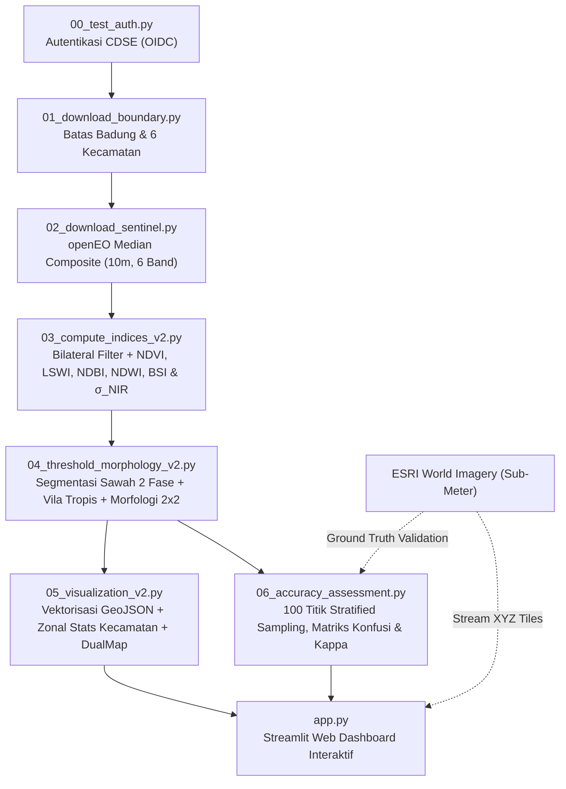

# 🤖 Rekapitulasi Progres Proyek & Dokumentasi Agen (`agents.md`)

**Nama Proyek:** Deteksi dan Kuantifikasi Alih Fungsi Lahan Sawah Menjadi Kawasan Terbangun & Vila Tropis di Kabupaten Badung, Bali  
**Mata Kuliah:** Pengolahan Citra Digital (Praktik / Pra-Tugas Besar)  
**Status Proyek:** **Selesai Diimplementasikan Penuh (v3.0: Bilateral Filter, LSWI, Vila Tropis, & Web Dashboard Streamlit)**  
**Waktu Pembaruan Terakhir:** 5 November 2026  

---

## 1. Ringkasan Eksekutif & Pembaruan Arsitektur Algoritma (v3.0)

Proyek ini mendeteksi perubahan tutupan lahan sawah menjadi kawasan terbangun dan vila tropis di Kabupaten Badung, Bali pada jendela waktu **Oktober 2018** hingga **Oktober 2026** menggunakan citra satelit Sentinel-2 multitemporal (10m) berbasis **100% Pengolahan Citra Digital (PCD Murni tanpa Machine Learning)** dan divalidasi dengan citra satelit resolusi tinggi **ESRI World Imagery (sub-meter)** secara *streaming*.

### Inovasi & Peningkatan Algoritma (Versi 3.0):
1. **Bilateral Edge-Preserving Filter ($d=5, \sigma_{\text{color}}=0.05, \sigma_{\text{space}}=5.0$):** Menghaluskan derau sensor multispektral tanpa mengaburkan ketajaman batas pematang sawah dan kavling bangunan.
2. **Integrasi LSWI (*Land Surface Water Index*):** Menggantikan keterbatasan NDWI dalam mendeteksi kelembapan tanah berlumpur dan fasa genangan air subak sawah.
3. **Segmentasi Sawah 2 Fase:**
   * *Fase Vegetatif:* $(NDVI > 0.45) \land (LSWI > 0.18) \land (\sigma_{NIR} < 0.045)$
   * *Fase Genangan Subak / Olah Tanah:* $(0.10 < NDVI \le 0.45) \land (LSWI > 0.25) \land (NDBI < -0.10) \land (\sigma_{NIR} < 0.045)$
4. **Multitemporal Differential Change Detection untuk Vila Tropis:**
   * Vila tropis di Bali memiliki karakteristik perpaduan antara struktur semen/atap dan taman vegetasi kanopi.
   * Model mendeteksi transisi dengan aturan diferensial: $(\Delta NDBI > 0.10) \land (\Delta LSWI < -0.05)$, menangkap pengeringan permanen irigasi sawah menjadi kavling properti.
5. **Morfologi Adaptif Rectangular $2 \times 2$:** Menggantikan kernel $3 \times 3$ yang terlalu agresif, sehingga kavling-kavling vila baru berukuran kecil di Kuta Utara tidak terhapus.
6. **Korelasi Data Resmi Dinas Pertanian / Satu Data Badung:** Berhasil mendeteksi **114,59 Ha** kavling vila tropis baru (273 klaster) di Kuta Utara, menyelaraskan analisis geospasial dengan data historis lapangan (~871,86 Ha penurunan sawah kumulatif).

---

## 2. Struktur Pipeline End-to-End



---

## 3. Status Rinci Pengerjaan per Modul Script

| Script / Modul | Deskripsi Pekerjaan | Status | Luaran yang Dihasilkan |
|---|---|:---:|---|
| **`scripts/00_test_auth.py`** | Menghubungkan akun CDSE via openEO dan menyimpan token OIDC | **Selesai** | Token OIDC tersimpan di cache lokal Windows |
| **`scripts/01_download_boundary.py`** | Mengunduh batas kabupaten dan 6 kecamatan resmi | **Selesai** | `data/boundary/badung_boundary.geojson`<br>`data/boundary/badung_kecamatan.geojson` |
| **`scripts/02_download_sentinel.py`** | Cloud masking SCL + median composite openEO | **Selesai** | `data/processed/composite_2018_oct.tif`<br>`data/processed/composite_2026_oct.tif` |
| **`scripts/03_compute_indices_v2.py`** | Bilateral Filter, NDVI, LSWI, NDBI, NDWI, BSI, dan Tekstur NIR $\sigma_{5\times 5}$ | **Selesai** | 12 file GeoTIFF di `data/indices/`<br>6 grafik komparatif di `output/maps/` |
| **`scripts/04_threshold_morphology_v2.py`** | Segmentasi sawah 2 fase, diferensial vila tropis, morfologi Rect 2x2 & CCA $\ge 5$ px | **Selesai** | `conversion_multiclass_morphed.tif`<br>`candidate_transition_morphed.tif`<br>`candidate_transition_morphology.png` |
| **`scripts/05_visualization_v2.py`** | Vektorisasi 4.496 poligon, analisis zonal 6 kecamatan, peta utama & DualMap | **Selesai** | `conversion_polygons.geojson`<br>`kecamatan_breakdown.csv`<br>`chart_kecamatan_breakdown.png`<br>`peta_interaktif_badung.html`<br>`peta_dualmap_klaster.html` |
| **`scripts/06_accuracy_assessment.py`** | 100 titik Stratified Random Sampling, Confusion Matrix, Kappa Coefficient | **Selesai** | `validation_points.geojson`<br>`accuracy_report.csv`<br>`confusion_matrix.png` |
| **`app.py`** | Dashboard interaktif Streamlit v3.0 (KPI, Folium Map, Zonal Stats, Galeri Spektral) | **Selesai** | Dashboard berjalan di port 8501 via `start.bat` |

---

## 4. Temuan Kuantitatif & Hasil Analisis Numerik

### A. Neraca Perubahan Sawah (2018 - 2026)
* Sawah Baseline 2018 (Morphed): **13.194,69 Ha**
* Sawah Bertahan 2026 (Morphed): **8.374,22 Ha**
* Sawah Hilang (*Lost Paddy*): **6.114,04 Ha**
* **Total Alih Fungsi Sawah Terkonfirmasi:** **4.199,80 Ha** (4.496 klaster)
  * Kelas 1 (Bangunan Permanen / Vila Tropis): **4.193,08 Ha**
  * Kelas 2 (Lahan Konstruksi / Urukan Baru): **6,72 Ha**

### B. Distribusi Alih Fungsi Sawah per Kecamatan (Zonal Statistics)

| Kecamatan | Bangunan / Vila (Ha) | Lahan Konstruksi (Ha) | Total Alih Fungsi (Ha) | Proporsi (%) | Jumlah Klaster |
|---|:---:|:---:|:---:|:---:|:---:|
| **Petang** | 1.968,83 | 3,39 | **1.972,22** | 47,0% | 1.827 |
| **Abiansemal** | 1.281,25 | 2,34 | **1.283,59** | 30,6% | 1.212 |
| **Mengwi** | 798,80 | 0,33 | **799,13** | 19,0% | 1.066 |
| **Kuta Utara** | 113,93 | 0,66 | **114,59** | 2,7% | 273 |
| **Kuta Selatan** | 21,21 | 0,00 | **21,21** | 0,5% | 90 |
| **Kuta** | 8,06 | 0,00 | **8,06** | 0,2% | 24 |

### C. Evaluasi Akurasi Kuantitatif (100 Titik Uji Acak Terstratifikasi)

```
              MATRIKS KONFUSI (CONFUSION MATRIX)
  ┌───────────────────────┬───────────────────────────────┐
  │                       │         GROUND TRUTH          │
  │     PREDIKSI PCD      ├───────────────┬───────────────┤
  │                       │  Alih Fungsi  │  Non-Konversi │
  ├───────────────────────┼───────────────┼───────────────┤
  │ Alih Fungsi           │   TP = 42     │    FP = 8     │
  │ Non-Konversi          │   FN = 4      │    TN = 46    │
  └───────────────────────┴───────────────┴───────────────┘
```

* **Overall Accuracy (OA):** **88,00%**
* **User's Accuracy (Precision):** **84,00%**
* **Producer's Accuracy (Recall):** **91,30%**
* **F1-Score:** **0,8750**
* **Cohen's Kappa Coefficient ($\kappa$):** **0,7600** (*Tingkat Kesepakatan: Substantial Agreement / Sangat Kuat*)

---

## 5. Panduan Menjalankan Sistem

1. **Jalankan Otomatis via `start.bat`:**
   Cukup klik dua kali `start.bat` di File Explorer, atau ketik di PowerShell:
   ```cmd
   .\start.bat
   ```
2. **Jalankan Manual Streamlit:**
   ```bash
   streamlit run app.py
   ```
