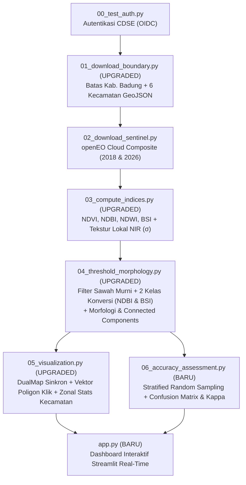

# 🚀 Implementation Plan (Upgrade v2.0): Peningkatan Akurasi Spasial & Visualisasi Interaktif Deteksi Alih Fungsi Sawah Kabupaten Badung (2018–2026)

**Nama Proyek:** Deteksi dan Kuantifikasi Alih Fungsi Lahan Sawah Menjadi Kawasan Terbangun di Kabupaten Badung, Bali  
**Versi Upgrade:** v2.0 (*Spatial Texture, Multi-Class BSI, Zonal Statistics, & Interactive Dashboard*)  
**Prinsip Metode:** 100% Pengolahan Citra Digital Murni (*Rule-Based*, Tekstur Spasial, & Morfologi Matematika — **Tanpa Machine Learning**)  
**Basis Proyek Sebelumnya:** `PRATUBES_BADUNG` (Pipeline `00` s/d `05`)

---

## 1. Latar Belakang & Tujuan Upgrade (Dari v1.0 ke v2.0)

Berdasarkan evaluasi terhadap sistem v1.0 (`agents.md`), pipeline dasar telah berhasil mengunduh komposit bersih Sentinel-2 (2018 & 2026) via openEO CDSE, menghitung 4 indeks spektral (NDVI, NDBI, NDWI, BSI), serta menerapkan operasi morfologi. Namun, terdapat **4 celah teknis** yang akan diselesaikan melalui *upgrade* v2.0 ini:

| No | Kelemahan pada Sistem v1.0 | Solusi Upgrade pada v2.0 (PCD Murni) |
| :-: | :--- | :--- |
| **1** | **Kebingungan Spektral Pohon vs Sawah (2018):** Syarat awal $NDVI_{2018} > 0.3$ menangkap seluruh vegetasi (termasuk hutan di Badung Utara & pohon sempadan sungai), sehingga tebangan pohon terhitung sebagai alih fungsi sawah. | **Penambahan Filter Tekstur Lokal ($\sigma_{NIR}$):** Menghitung *Local Standard Deviation* ukuran $5 \times 5$ pada Band NIR 2018 untuk memisahkan permukaan sawah yang rata ($\sigma$ rendah) dari kanopi pepohonan yang kasar ($\sigma$ tinggi). |
| **2** | **Indeks BSI Belum Dimanfaatkan di Tahap Klasifikasi:** `bsi_2018.tif` dan `bsi_2026.tif` sudah dihitung di `03_compute_indices.py`, tetapi belum masuk ke aturan logika di `04_threshold_morphology.py`. | **Klasifikasi Transisi 2 Kelas (Bangunan vs Lahan Konstruksi/Urukan):** Memisahkan alih fungsi menjadi **Kelas 1: Terbangun Permanen** (berbasis NDBI) dan **Kelas 2: Bukaan Lahan / Proyek Urukan Kapur** (berbasis lonjakan BSI). |
| **3** | **Analisis Masih Agregat Satu Kabupaten:** Luas konversi (245,74 ha) belum dipecah per kecamatan, padahal laju alih fungsi di Kuta Utara dan Mengwi sangat berbeda dengan Petang. | **Zonal Statistics Level Kecamatan:** Mengunduh batas 6 kecamatan di Kabupaten Badung dan menghitung tabel distribusi alih fungsi per kecamatan secara otomatis. |
| **4** | **Visualisasi Hanya Berupa Layer Statis & Toggle Biasa:** Peta HTML v1.0 menggunakan *raster overlay* yang tidak bisa diklik per klaster dan sulit dibandingkan secara berdampingan. | **Vektorisasi Poligon Klik + DualMap + Dashboard Streamlit:** Mengubah *mask* morfologi menjadi poligon GeoJSON interaktif (klik untuk info luas hektar & nilai indeks), *split-screen map*, dan aplikasi web `app.py`. |

---

## 2. Arsitektur Pipeline v2.0 yang Diperbarui



---

## 3. Rincian Rencana Implementasi per Modul

### Modul 1: Upgrade Batas Wilayah per Kecamatan (`scripts/01_download_boundary.py`)
* **Tujuan:** Menyediakan poligon batas administrasi 6 kecamatan di Kabupaten Badung (**Kuta Selatan, Kuta, Kuta Utara, Mengwi, Abiansemal, Petang**) untuk analisis *Zonal Statistics*.
* **Langkah Implementasi:**
  1. Menambahkan query Overpass API / Nominatim OpenStreetMap atau GADM Level-3 (`GID_2 == Badung`) untuk mengekstrak poligon per kecamatan.
  2. Menyimpan luaran baru ke `data/boundary/badung_kecamatan.geojson`.

---

### Modul 2: Penambahan Fitur Tekstur Spasial NIR (`scripts/03_compute_indices.py`)
* **Tujuan:** Mengatasi *false positive* pepohonan/hutan yang terdeteksi sebagai sawah tanpa menggunakan *machine learning*.
* **Landasan Matematis:**
  Pada citra *single-date* / komposit bulanan, kanopi pohon menghasilkan variasi bayangan internal antar-tajuk yang kasar pada gelombang *Near-Infrared* (Band 8), sedangkan hamparan padi subak memiliki permukaan tajuk yang homogen. Simpangan baku lokal (*Local Standard Deviation*) dihitung dengan jendela geser $5 \times 5$ piksel ($50\text{ m} \times 50\text{ m}$):
  $$\sigma_{NIR}(x,y) = \sqrt{\frac{1}{N}\sum_{(i,j)\in W} B8(i,j)^2 - \left(\frac{1}{N}\sum_{(i,j)\in W} B8(i,j)\right)^2}$$
* **Langkah Implementasi:**
  1. Menggunakan `scipy.ndimage.uniform_filter` pada Band 8 tahun 2018 untuk menghitung matriks $\sigma_{NIR, 2018}$.
  2. Menyimpan hasil raster tekstur ke `data/indices/texture_nir_2018.tif` dan grafik distribusinya ke `output/maps/comparison_texture.png`.

---

### Modul 3: Upgrade Multi-Rule Thresholding & Morfologi 2 Kelas (`scripts/04_threshold_morphology.py`)
* **Tujuan:** Memurnikan deteksi sawah awal tahun 2018 dan membagi alih fungsi tahun 2026 menjadi 2 kategori fisik (Terbangun Permanen vs Lahan Konstruksi/Urukan).
* **Formulasi Aturan Logika Baru:**
  1. **Syarat Lahan Sawah Murni 2018 ($M_{\text{sawah\_2018}}$):**
     $$M_{\text{sawah\_2018}} = (NDVI_{2018} > 0.35) \land (\sigma_{NIR, 2018} < 0.045) \land (NDWI_{2018} > -0.55)$$
     *(Mengeliminasi hutan lebat/pepohonan bertekstur kasar dengan syarat $\sigma_{NIR, 2018} < 0.045$).*
  2. **Kelas 1 — Alih Fungsi Menjadi Bangunan Permanen ($C_{\text{bangunan}}$):**
     $$C_{\text{bangunan}} = M_{\text{sawah\_2018}} \land (NDVI_{2026} \le 0.30) \land (NDBI_{2026} > 0.10) \land (\Delta NDBI > 0.08) \land (NDWI_{2026} \le 0)$$
  3. **Kelas 2 — Alih Fungsi Menjadi Lahan Urukan / Konstruksi Baru ($C_{\text{konstruksi}}$):**
     $$C_{\text{konstruksi}} = M_{\text{sawah\_2018}} \land (\neg C_{\text{bangunan}}) \land (NDVI_{2026} \le 0.25) \land (BSI_{2026} > 0.08) \land (\Delta BSI > 0.10)$$
* **Penyempurnaan Operasi Morfologi:**
  1. Menerapkan **Morphological Opening ($3 \times 3$ Persegi)** untuk mengikis derau garis jalan/pematang sempit.
  2. Menerapkan **Connected Component Area Filtering (`cv2.connectedComponentsWithStats`)** untuk membuang bercak poligon terisolasi yang luasnya $< 10\text{ piksel}$ ($< 0,10\text{ Ha}$).
  3. Menerapkan **Morphological Closing ($3 \times 3$ Persegi)** untuk menyatukan klaster atap vila/perumahan yang berdekatan.
  4. Menyimpan raster hasil ke `data/results/conversion_multiclass_morphed.tif` (Nilai `0` = Non-Konversi, `1` = Terbangun Permanen, `2` = Konstruksi/Tanah Urukan).

---

### Modul 4: Upgrade Visualisasi Interaktif & Vektorisasi Poligon (`scripts/05_visualization.py`)
* **Tujuan:** Membuat hasil deteksi mudah dieksplorasi secara visual, bisa diklik per petak sawah yang berubah, serta merinci statistik per kecamatan.
* **Fitur Baru yang Diimplementasikan:**
  1. **Vektorisasi Raster ke GeoJSON (`rasterio.features.shapes`):**
     Mengonversi setiap klaster piksel pada `conversion_multiclass_morphed.tif` menjadi poligon vektor di `GeoDataFrame`, menghitung luas masing-masing poligon dalam satuan Hektar (`EPSG:32750`), dan mengambil nilai rata-rata $\Delta NDVI$, $\Delta NDBI$, serta $\Delta BSI$ di dalam poligon tersebut.
  2. **Peta Sinkronisasi Dua Layar (`folium.plugins.DualMap`):**
     * **Panel Kiri:** Citra Komposit/Indeks Tahun 2018 (Kondisi Awal Sawah Subak).
     * **Panel Kanan:** Streaming **ESRI World Imagery (Sub-Meter)** + Poligon Vektor Interaktif (**Merah** untuk Bangunan Permanen, **Oranye** untuk Lahan Konstruksi/Urukan).
     * **Interaktivitas Hover/Klik:** Saat pengguna mengarahkan mouse ke suatu poligon merah/oranye di Kuta Utara atau Mengwi, muncul *tooltip* berisi: `ID Klaster`, `Kecamatan`, `Status Konversi`, `Luas (Ha)`, dan `Perubahan NDVI/NDBI`.
  3. **Zonal Statistics per Kecamatan:**
     Melakukan *spatial join* (`gpd.overlay` / `gpd.sjoin`) antara poligon alih fungsi dengan `badung_kecamatan.geojson` untuk menghasilkan tabel `output/statistics/kecamatan_breakdown.csv` dan grafik batang peringkat alih fungsi per kecamatan.

---

### Modul 5: Penambahan Skrip Evaluasi Akurasi Kuantitatif (`scripts/06_accuracy_assessment.py`)
* **Tujuan:** Memberikan bukti validasi ilmiah (kuantitatif) untuk melengkapi klaim validasi visual pada laporan Tugas Besar.
* **Langkah Implementasi:**
  1. Membangkitkan **100 titik koordinat uji secara acak berstrata (*Stratified Random Sampling*)**: 50 titik pada area terdeteksi alih fungsi dan 50 titik pada area non-alih fungsi.
  2. Mengekspor titik tersebut ke `output/validation/validation_points.geojson` dan menampilkannya sebagai *marker* di peta ESRI World Imagery untuk verifikasi *ground-truth* cepat.
  3. Menghitung matriks evaluasi standar penginderaan jauh:
     * **Confusion Matrix ($2 \times 2$)**
     * **Overall Accuracy (OA)**
     * **User's Accuracy (Precision)** & **Producer's Accuracy (Recall)**
     * **Kappa Coefficient ($\kappa$):**
       $$\kappa = \frac{P_o - P_e}{1 - P_e}$$

---

### Modul 6: Pembuatan Dashboard Aplikasi Web Lokal (`app.py` dengan Streamlit)
* **Tujuan:** Menyediakan antarmuka grafis (GUI) interaktif saat demo/sidang Tugas Besar tanpa perlu mengubah kode secara manual di teks editor.
* **Fitur Dashboard Streamlit:**
  * **Sidebar Kontrol Parameter:** Slider untuk mengubah ambang $NDVI_{2018}$, $NDBI_{2026}$, $BSI_{2026}$, $\sigma_{NIR}$, serta *dropdown* pemilihan jenis Kernel Morfologi (*Cross 3x3*, *Square 3x3*, *Square 5x5*) dan filter Kecamatan.
  * **Panel Metrik Utama (KPI Cards):** Menampilkan Total Luas Sawah Terkonversi (Ha), Luas Bangunan Permanen (Ha), Luas Lahan Proyek/Urukan (Ha), dan Kecamatan Terdampak Terbesar secara *real-time*.
  * **Tab Visualisasi:**
    * *Tab 1:* Peta Interaktif Folium + ESRI Sub-Meter.
    * *Tab 2:* Grafik Batang Alih Fungsi per Kecamatan & Kurva Sensitivitas Kernel (`parameter_sweep.csv`).
    * *Tab 3:* Eksplorasi Perbandingan Citra Indeks (NDVI, NDBI, NDWI, BSI, Tekstur NIR).

---

## 4. Pembaruan Struktur Direktori Proyek (Target v2.0)

```text
PRATUBES_BADUNG/
├── agents.md                                 # Dokumentasi progres agen
├── upgrade_implementation_plan.md            # Dokumen rencana upgrade v2.0 (berkas ini)
├── laporan.md                                # Laporan tugas besar
├── config.py                                 # (+) Parameter th_sigma_nir, th_bsi, min_area_px
├── requirements.txt                          # (+) Tambahan: streamlit, streamlit-folium
├── app.py                                    # [BARU] Dashboard Web Interaktif Streamlit
│
├── scripts/
│   ├── 00_test_auth.py
│   ├── 01_download_boundary.py               # [UPGRADE] Unduh batas 6 Kecamatan Badung
│   ├── 02_download_sentinel.py
│   ├── 03_compute_indices.py                 # [UPGRADE] Tambah ekstraksi Tekstur NIR (σ)
│   ├── 04_threshold_morphology.py            # [UPGRADE] Filter tekstur + 2 Kelas (NDBI & BSI) + Area Filter
│   ├── 05_visualization.py                   # [UPGRADE] Vektorisasi Poligon Klik + DualMap + Zonal Stats
│   └── 06_accuracy_assessment.py             # [BARU] Sampling validasi & perhitungan Confusion Matrix / Kappa
│
├── data/
│   ├── boundary/
│   │   ├── badung_boundary.geojson
│   │   └── badung_kecamatan.geojson          # [BARU] Poligon 6 Kecamatan di Kab. Badung
│   ├── indices/
│   │   ├── (ndvi, ndbi, ndwi, bsi 2018 & 2026)
│   │   └── texture_nir_2018.tif              # [BARU] Raster simpangan baku lokal Band NIR 2018
│   └── results/
│       ├── candidate_transition_morphed.tif
│       ├── conversion_multiclass_morphed.tif # [BARU] Raster 2 kelas (1: Bangunan, 2: Konstruksi/BSI)
│       └── conversion_polygons.geojson       # [BARU] Hasil vektorisasi klaster beserta atribut luas (Ha)
│
└── output/
    ├── maps/
    │   ├── peta_interaktif_badung.html
    │   ├── peta_dualmap_klaster.html         # [BARU] Peta split-screen dengan poligon klik
    │   └── chart_kecamatan_breakdown.png     # [BARU] Grafik alih fungsi per kecamatan
    └── statistics/
        ├── parameter_sweep.csv
        ├── final_statistics.csv
        ├── kecamatan_breakdown.csv           # [BARU] Tabel kuantifikasi luas per kecamatan
        └── accuracy_report.csv               # [BARU] Hasil Confusion Matrix & Kappa Coefficient
```

---

## 5. Urutan Eksekusi Upgrade (Checklist Tahapan Kerja)

- [ ] **Tahap 1 — Update Konfigurasi (`config.py` & `requirements.txt`):** Tambahkan `streamlit` dan `streamlit-folium` pada `requirements.txt`, serta definisikan konstanta `TH_SIGMA_NIR = 0.045`, `TH_BSI_2026 = 0.08`, dan `MIN_CLUSTER_PIXELS = 10` di `config.py`.
- [ ] **Tahap 2 — Ekstraksi Tekstur & Batas Kecamatan:** Jalankan pembaruan pada `01_download_boundary.py` dan `03_compute_indices.py` untuk menghasilkan `badung_kecamatan.geojson` serta `texture_nir_2018.tif`.
- [ ] **Tahap 3 — Eksekusi Aturan Transisi Multi-Kelas & Morfologi:** Jalankan `04_threshold_morphology.py` yang telah di-upgrade untuk memisahkan konversi bangunan permanen vs lahan konstruksi serta mengeliminasi noise pohon.
- [ ] **Tahap 4 — Generate Peta Poligon Interaktif & Statistik Kecamatan:** Jalankan `05_visualization.py` untuk menghasilkan `conversion_polygons.geojson`, `kecamatan_breakdown.csv`, dan `peta_dualmap_klaster.html`.
- [ ] **Tahap 5 — Uji Akurasi & Peluncuran Dashboard:** Jalankan `06_accuracy_assessment.py` untuk mendapatkan skor akurasi, lalu jalankan perintah `streamlit run app.py` untuk membuka dashboard interaktif di browser.